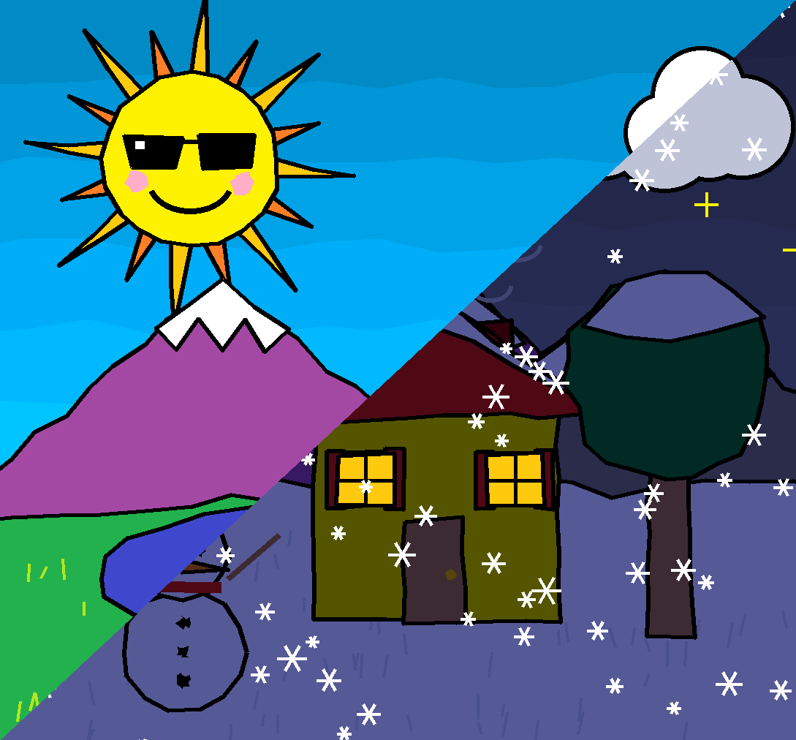

Change le fond d'écran GNOME selon la météo (wttr.in), avec une variante jour et nuit. Les fonds d'écran fournis sont générés

## Installer

```
./install.sh
```

Le script demande la ville, le dossier des images et un éventuel proxy. Il génère ensuite les images à la résolution de ton écran et active un timer systemd utilisateur qui rafraîchit le fond toutes les 30 minutes.

Pour une installation sans questions :

```
./install.sh --ville Lyon --proxy http://proxy.toto.fr:8080
```

`./install.sh --help` liste toutes les options.

## Prérequis

- GNOME (`gsettings`)
- `curl` ou `wget`
- `python3` avec Pillow, ou `python3-venv` pour que le script installe Pillow lui-même

Sans Pillow, utilise tes propres images avec `--images DIR`.

## Personnaliser

- Ville, dossier et proxy : `~/.config/meteo-wallpaper/config`, relu chaque fois.
- Visages du soleil et des nuages : dictionnaire `VISAGES` en haut de `gen_wallpapers.py`, puis `./install.sh --regenerer`.
- Images perso : nomme-les `soleil-jour`, `nuageux-nuit`, `pluie-jour`, `orage-nuit`, `neige-jour`, `brouillard-nuit`, etc. (extension libre), plus un `defaut` en repli.

## Tester et dépanner

```
meteo-wallpaper --code 389 --nuit         # force orage de nuit
journalctl --user -u meteo-wallpaper       # logs
systemctl --user list-timers meteo-wallpaper.timer
```

## Désinstaller

```
./install.sh --desinstaller
```

La config et les images sont conservées.
